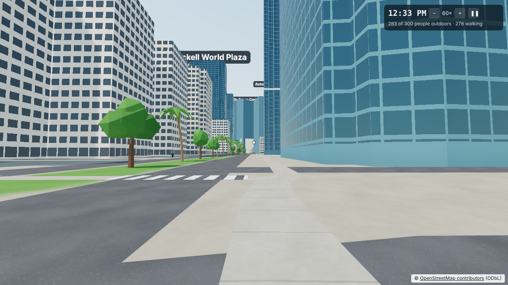
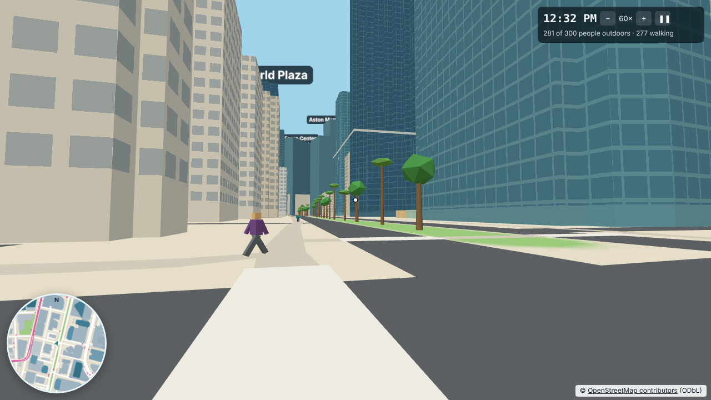
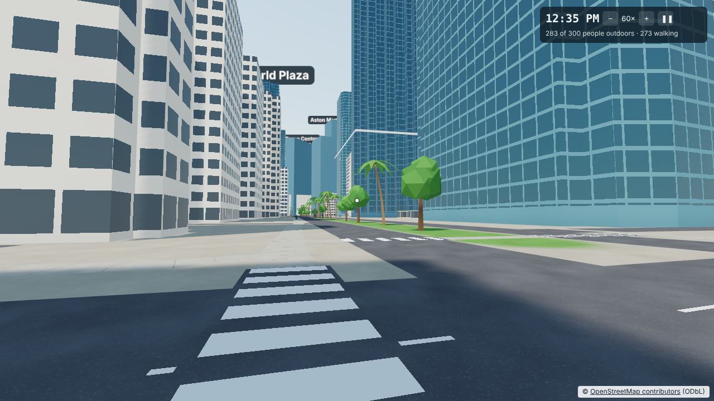
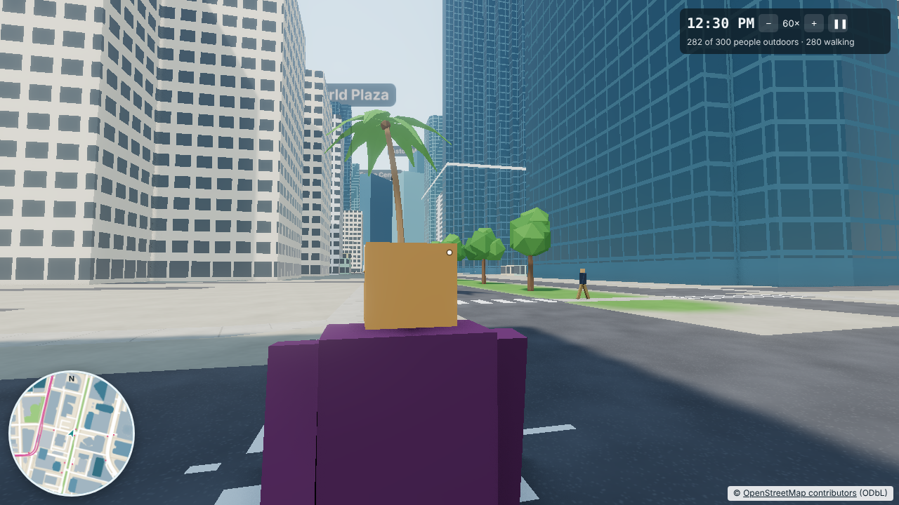
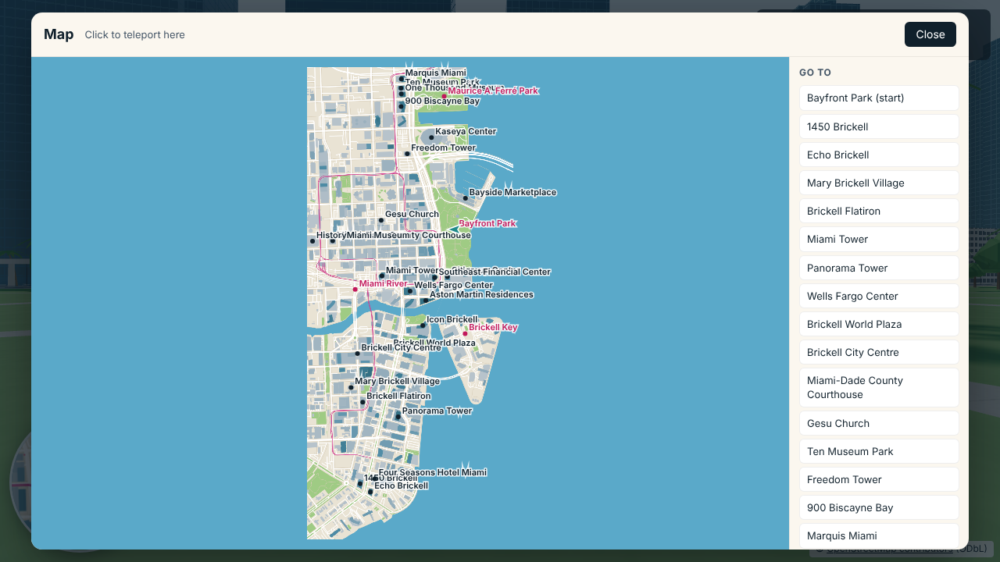

# Dynamic City Renderer

A stylized, walkable (and flyable), first-person 3D model of central Miami: a 6 × 6 km area centered on Axis at Brickell Village. It covers Brickell, Downtown, Brickell Key, Little Havana, Overtown, The Roads, PortMiami and the start of the Rickenbacker Causeway. It's built in the browser with Three.js from OpenStreetMap data. You can walk Brickell Avenue, cross the Miami River, loop around Bayfront Park, and watch about 300 people follow daily routines on a simulated clock.


| Street level, Brickell Avenue | Crowd on a downtown sidewalk |
|---|---|
|  |  |

2D check map of the processed data: [`docs/map-preview.png`](docs/map-preview.png)

### Graphics quality

Pick **Low**, **Medium** (default) or **High** on the start panel, or press **G**. The choice is saved in the browser.

| Low (original stylized look) | Medium | High |
|---|---|---|
|  |  |  |

- **Medium:** realistic materials and reflective glass, generated textures, painted road markings, a sky, sun shadows, palms and shade trees, street lamps, benches, bus shelters and parked cars.
- **High:** adds sharper shadows, ambient occlusion and a little bloom.
- **If it stutters,** use Low. Frame rates on real GPUs have not been measured yet (see TESTING.md).

## Run it

Requires Node 20 or newer.

```bash
npm install
npm run dev            # http://localhost:5173
```

| Command | What it does |
|---|---|
| `npm run dev` | Development server with hot reload |
| `npm run build` | Static site in `dist/` (about 6 MB, any static host works) |
| `npm run build:single` | One self-contained `dist-single/index.html` (about 1.9 MB) for sharing as a file |
| `npm run preview` | Serves `dist/` locally |
| `npx vite build --mode artifact` | One page with the code inlined plus `district.json` beside it, for hosting as a claude.ai Artifact |
| `npm run pipeline` | Rebuilds `data/district.json` from the cached OSM download |
| `npm run pipeline:refresh` | Re-downloads OSM data, then rebuilds |
| `npm run test:e2e` | Acceptance tests in headless Chromium (see TESTING.md) |

**Deploy:** `.github/workflows/pages.yml` builds and publishes to GitHub Pages on every push to `main`. Turn it on once under *Settings → Pages → Source: GitHub Actions*.

**Tests** need Playwright and Chromium, which are not project dependencies. To set them up: `npm i -D playwright && npx playwright install chromium`.

**Behind a proxy**, Node's `fetch` ignores `HTTPS_PROXY` unless you run `NODE_USE_ENV_PROXY=1 npm run pipeline:refresh` (Node 22.21 or newer).

## Controls

| Key | Action |
|---|---|
| Click | Start (locks the mouse). While walking, click a person at the center of the screen to see their activity. |
| W A S D / arrows | Move |
| Mouse | Look |
| Shift | Sprint |
| Space | Jump |
| Space Space (double-tap) | Start / stop flying (Minecraft creative mode) |
| Space / Shift while flying | Fly up / down |
| W W (double-tap and hold) | Run or fly fast |
| + / − or mouse wheel | Walking and flying speed, 0.5× to 12× (remembered) |
| R | Return to Bayfront Park |
| M (or click the minimap) | Open the map. Click anywhere to teleport, Shift+click a building to land on its roof, or pick a place from the list |
| P, [ , ] | Pause the clock, slower, faster (1× to 600×) |
| L | Labels on/off |
| G | Next graphics quality (reloads) |
| V | Next style: Normal, Miami Vice, Noir |
| ` (backtick) | Debug overlay: FPS, draw calls, triangles, position, NPC timing |
| Esc | Release the mouse |

URL options: `?npcs=200` (0 to 400), `?hour=17.5` (start time), `?quality=low|medium|high`.

### Map and teleporting

- **Minimap:** the round map in the bottom-left corner. It follows you with north up and shows people outdoors as pink dots.
- **Full map:** press **M** or click the minimap. Click a spot to teleport to the nearest open street-level ground there. **Shift+click** a building to land on its roof. The list on the right jumps to any landmark or place.



### Flying

Flying works like Minecraft creative mode:
- **Start and stop:** double-tap Space. Hold Space to climb and Shift to descend, up to 800 m.
- **Faster:** double-tap and hold W.
- **Landing:** touching down on a rooftop or the street ends flight. You can then walk across the roof and drop off the edge.
- **Collision:** buildings stay solid at every height, so you fly around towers or over them.
- **Water:** you can't land on the bay or the river; you hover just above it.

### Traffic and people

- **Moving traffic:** about 600 cars on Medium (300 on Low, 900 on High) drive the real road network on the right-hand side. They keep a gap to the car ahead and pause at some intersections. Traffic is generated in a bubble around you, so streets look busy wherever you go. Car models load in the background after the first frame.
- **Parked cars:** about 1,500 line local streets on Medium and High.
- **Car models:** both use Kenney's **Car Kit** (CC0, www.kenney.nl): 12 models including sedans, SUVs, taxis, police cars, vans, trucks, delivery vans, an ambulance and a garbage truck. Each set of cars draws in one batch.
- **People:** an ambient crowd around you, 1,500 on Medium (600 Low, 2,500 High). People walk the sidewalks, are recycled as you move, and thin out at night. Use `?npcs=` to change the count and `?traffic=off` to turn cars off.

### Styles

Pick a **Style** on the start screen or press **V**: Normal, **Miami Vice** (sunset sky, neon windows, pink-and-teal grade with bloom and grain) or **Noir** (black-and-white, hard contrast, grain). Styles switch instantly. In Photoreal, the grade works as a filter over Google's scan.

## How it works

```
pipeline/            Node scripts: fetch -> clean -> project -> heights -> walk graph -> JSON + 2D preview
  config.mjs         bounding box, tolerances, default heights (all values explained in DECISIONS.md)
  fetch.mjs          Overpass (with mirrors), falling back to tiled OSM API downloads; cached in pipeline/cache/
  process.mjs        footprints, parts, heights, coastline -> land, water, parks, roads, rail, POIs, walk graph
  preview.mjs        top-down SVG/PNG check map
  run.mjs            one-command entry point; writes data/district.json and docs/pipeline-report.json
data/
  district.json      processed data the app loads (4.9 MB)
  landmarks.json     hand-editable landmark heights and labels
src/
  world.js           merged chunk meshes, LOD boxes, facade/road shaders, sky, shadows, water, ground, rail, labels
  props.js           palms, trees, lamps, benches, bus shelters, parked cars (chunked instancing)
  textures.js        procedural tileable textures
  quality.js         Low / Medium / High presets
  minimap.js         corner minimap + full map with click-to-teleport
  vehicles.js        parked cars + moving traffic (Kenney Car Kit models, BatchedMesh)
  photoreal.js       Google Photorealistic 3D Tiles mode
  collision.js       footprint polygons in a grid + 1 m land/water raster; sliding movement
  player.js          pointer-lock first-person controller
  npc.js             walk graph + A*, routines, separation steering, instanced procedural bodies
  main.js            app loop, clock, HUD, debug overlay, NPC inspection
tests/e2e.mjs        automated acceptance checks
```

- **Units:** 1 unit = 1 meter. Data uses x = east and y = north; Three.js uses (x, height, -y).
- **Editing landmark heights:** change `data/landmarks.json`, run `npm run pipeline`, and set `"verified": true` once you have checked the source.

## Docs

- [DECISIONS.md](DECISIONS.md): every judgment call and the defaults waiting on your confirmation
- [TESTING.md](TESTING.md): acceptance checks, measured numbers, and what is still untested
- [docs/pipeline-report.json](docs/pipeline-report.json): counts, dropped shapes, default-height buildings, landmark diffs

## Future work (out of scope for v1)

Photorealistic textures or photogrammetry, traffic simulation, talking NPCs, multiplayer, building interiors. Also possible: day/night lighting tied to the clock, real curb heights and terrain, touch controls for mobile, and an optional Google Photorealistic 3D Tiles mode (needs an API key; see the discussion in DECISIONS.md).

## License and attribution

- Code: MIT (see `LICENSE`).
- Car models: Kenney Car Kit, CC0 (see `assets/cars/License.txt`).
- Map data: **© OpenStreetMap contributors**, under the ODbL (see `DATA_LICENSE.md`). The app shows this attribution at all times.
