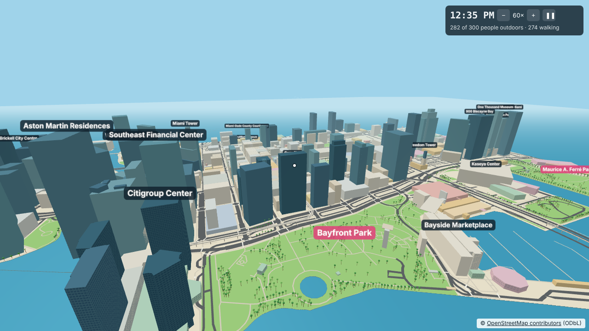
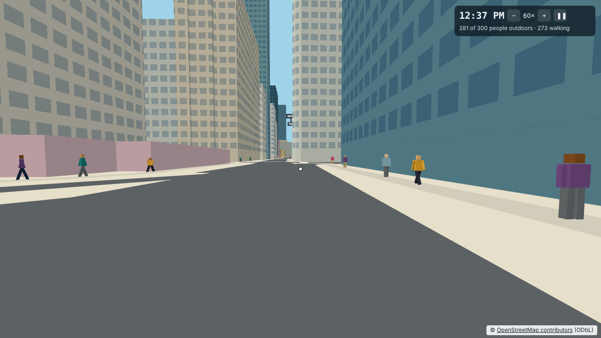

# Miami 3D: Downtown and Brickell

A stylized, walkable, first-person 3D model of Downtown and Brickell, Miami, built in the browser with Three.js from OpenStreetMap data. You can walk Brickell Avenue, cross the Miami River, loop around Bayfront Park, and watch about 300 people follow daily routines on a simulated clock.



| Street level, Brickell Avenue | Crowd on a downtown sidewalk |
|---|---|
|  |  |

2D check map of the processed data: [`docs/map-preview.png`](docs/map-preview.png)

## Run it

Requires Node 20 or newer.

```bash
npm install
npm run dev            # http://localhost:5173
```

| Command | What it does |
|---|---|
| `npm run dev` | Development server with hot reload |
| `npm run build` | Static site in `dist/` (about 1.6 MB, any static host works) |
| `npm run build:single` | One self-contained `dist-single/index.html` (about 1.9 MB) for sharing as a file |
| `npm run preview` | Serves `dist/` locally |
| `npm run pipeline` | Rebuilds `data/district.json` from the cached OSM download |
| `npm run pipeline:refresh` | Re-downloads OSM data, then rebuilds |
| `npm run test:e2e` | Acceptance tests in headless Chromium (see TESTING.md) |

**Deploy:** `.github/workflows/pages.yml` builds and publishes to GitHub Pages on every push to `main`. Turn it on once under *Settings → Pages → Source: GitHub Actions*.

**Tests** need Playwright and Chromium, which are not project dependencies. To set them up: `npm i -D playwright && npx playwright install chromium`.

**Behind a proxy**, Node's `fetch` ignores `HTTPS_PROXY` unless you run `NODE_USE_ENV_PROXY=1 npm run pipeline:refresh` (Node 22.21 or newer).

## Controls

| Key | Action |
|---|---|
| Click | Start (locks the mouse). While walking, click a person at the center of the screen to see their activity. |
| W A S D / arrows | Move |
| Mouse | Look |
| Shift | Sprint |
| Space | Jump |
| R | Return to Bayfront Park |
| P, [ , ] | Pause the clock, slower, faster (1× to 600×) |
| L | Labels on/off |
| ` (backtick) | Debug overlay: FPS, draw calls, triangles, position, NPC timing |
| Esc | Release the mouse |

URL options: `?npcs=200` (0 to 400) and `?hour=17.5` (start time).

## How it works

```
pipeline/            Node scripts: fetch -> clean -> project -> heights -> walk graph -> JSON + 2D preview
  config.mjs         bounding box, tolerances, default heights (all values explained in DECISIONS.md)
  fetch.mjs          Overpass (with mirrors), falling back to tiled OSM API downloads; cached in pipeline/cache/
  process.mjs        footprints, parts, heights, coastline -> land, water, parks, roads, rail, POIs, walk graph
  preview.mjs        top-down SVG/PNG check map
  run.mjs            one-command entry point; writes data/district.json and docs/pipeline-report.json
data/
  district.json      processed data the app loads (0.87 MB)
  landmarks.json     hand-editable landmark heights and labels
src/
  world.js           merged chunk meshes, LOD boxes, window shader, ground texture, roads, rail, trees, labels
  collision.js       footprint polygons in a grid + 1 m land/water raster; sliding movement
  player.js          pointer-lock first-person controller
  npc.js             walk graph + A*, routines, separation steering, instanced procedural bodies
  main.js            app loop, clock, HUD, debug overlay, NPC inspection
tests/e2e.mjs        automated acceptance checks
```

- **Units:** 1 unit = 1 meter. Data uses x = east and y = north; Three.js uses (x, height, -y).
- **Editing landmark heights:** change `data/landmarks.json`, run `npm run pipeline`, and set `"verified": true` once you have checked the source.

## Docs

- [DECISIONS.md](DECISIONS.md): every judgment call and the defaults waiting on your confirmation
- [TESTING.md](TESTING.md): acceptance checks, measured numbers, and what is still untested
- [docs/pipeline-report.json](docs/pipeline-report.json): counts, dropped shapes, default-height buildings, landmark diffs

## Future work (out of scope for v1)

Photorealistic textures or photogrammetry, traffic simulation, talking NPCs, multiplayer, building interiors. Also possible: day/night lighting tied to the clock, real curb heights and terrain, touch controls for mobile.

## License and attribution

- Code: MIT (see `LICENSE`).
- Map data: **© OpenStreetMap contributors**, under the ODbL (see `DATA_LICENSE.md`). The app shows this attribution at all times.
